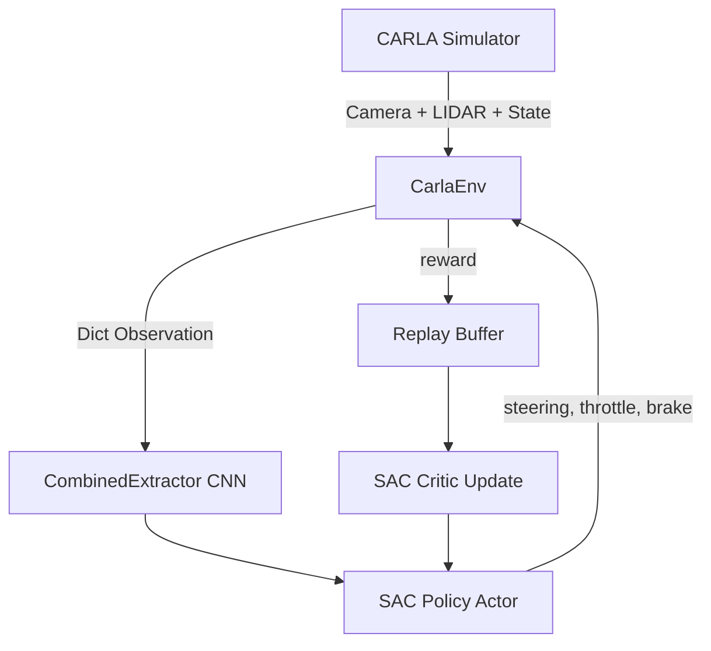

# 🚗 Carla Self-Driving Car — Full Project Analysis

## 📁 Project Structure

```
Carla-Self-Driving-Car-main/
├── carla_env.py          # ~2,948 lines — Core RL environment + CustomSAC model
├── train_sac_carla.py    # ~1,117 lines — Training entry point + neural nets
├── sac_tensorboard/      # TensorBoard logs (training already ran)
│   ├── SAC_1/            # TensorBoard run folder
│   └── progress.csv      # Training progress CSV
└── README.md
```

---

## 🧠 Architecture Overview

### What This Project Does

It trains a simulated self-driving car inside the [CARLA simulator](https://carla.org/) using **Soft Actor-Critic (SAC)** — an off-policy deep reinforcement learning algorithm.



---

## 📄 File-by-File Breakdown

### [`carla_env.py`](file:///c:/Users/dhruv/OneDrive/Desktop/Startups/Carla-Self-Driving-Car-main/Carla-Self-Driving-Car-main/carla_env.py) — The Environment

#### `CustomSAC` (lines 45–762)
- Subclass of Stable-Baselines3's `SAC`
- Implements the original Haarnoja et al. (2018) paper **exactly**:
  - Target entropy `H̄ = -dim(A) = -3.0` (fixed, for 3D action space)
  - `α` (entropy coefficient) learned automatically — **no clamping**
- Custom `save()` / `load()` that bypass cloudpickle (CARLA objects aren't picklable)
- Compressed replay buffer save/load with LZMA (~60-70% size reduction)

#### `CarlaEnv` (lines 768–end)
- Gymnasium environment wrapping CARLA
- Connects to CARLA server at `localhost:2000`
- **Observation space** (Dict):
  | Key | Shape | Type | Description |
  |-----|-------|------|-------------|
  | `image` | `(128, 128, 1)` | `uint8` | Grayscale forward camera |
  | `state` | `(4,)` | `float32` | `[x, y, speed_mps, yaw]` |
  | `lidar_bev` | `(64, 64, 1)` | `uint8` | Bird's-eye LIDAR occupancy grid |

- **Action space**: Box `[-1,1] × [0,1] × [0,1]` → `[steering, throttle, brake]`
- **Sensors spawned**: RGB visualization camera, grayscale forward camera, LIDAR, IMU, collision sensor, lane invasion sensor
- **Reward shaping**: speed maintenance, collision penalty, lane invasion penalty, smoothness bonus, distance bonus
- **NPC vehicles**: 5 autopilot cars to simulate traffic
- **Map rotation**: Optional, cycles through available Town maps
- Arduino serial feedback: sends speed/reward data to hardware display (optional, gracefully disabled without `pyserial`)

---

### [`train_sac_carla.py`](file:///c:/Users/dhruv/OneDrive/Desktop/Startups/Carla-Self-Driving-Car-main/Carla-Self-Driving-Car-main/train_sac_carla.py) — Training Script

#### Key Classes

| Class | Purpose |
|-------|---------|
| `ResidualBlock` | Standard residual conv block (Conv→BN→ReLU + skip connection) |
| `CombinedExtractor` | Custom feature extractor combining CNN + LIDAR CNN + State MLP |
| `FixedScheduleLRCallback` | Decays LR `3e-4 → 1.5e-4` over 300k steps |
| `EntropyLoggingCallback` | Logs entropy coefficient `α` every 1k steps |
| `EnvMetricsCallback` | Logs driving metrics (speed, collisions, lane invasions) |
| `ReplayBufferCheckpointCallback` | Full checkpoint (model + replay buffer) every 10k steps |
| `CustomCheckpointCallback` | Lightweight model-only checkpoint every 2k steps |

#### `CombinedExtractor` — The Neural Network

```
Input:
  image (128×128×1 grayscale)
  lidar_bev (64×64×1 occupancy grid)
  state (4D vector)

Processing:
  Image CNN:    Conv8s4 → ResBlock(64) → Conv4s2 → ResBlock(128) → Conv3s1 → ResBlock(256) → AdaptiveAvgPool(4×4) → Flatten → 4096
  LIDAR CNN:    Conv5s2 → Conv3s2 → Conv3s2 → Flatten → ~2304
  State MLP:    Linear(4→64) → Linear(64→60) → 60

Feature Distribution (total = 2048):
  Camera:  1106 features (54%) — lane following
  LIDAR:    882 features (43%) — obstacle avoidance
  State:     60 features (3%)  — speed/position

Fusion: Attention-weighted concat → FC(2048→512) → FC(512→256)
```

#### SAC Hyperparameters (default training)

| Parameter | Value |
|-----------|-------|
| Learning rate | `2e-4` (static) |
| Buffer size | 150,000 transitions |
| Batch size | 128 |
| Tau (soft update) | `0.004` |
| `learning_starts` | 1,000 steps |
| Policy net arch | `[256, 512]` (pi and qf) |
| Features dim | 256 |
| Checkpointing | Every 2k steps (model), 10k steps (full) |

---

## ✅ How to Run the Project

### Step 1 — Prerequisites

Install Python dependencies:
```powershell
pip install stable-baselines3 gymnasium torch numpy opencv-python pygame rich optuna tensorboard
```

> **Optional** (for Arduino hardware display):
> ```powershell
> pip install pyserial
> ```

Install the CARLA Python API (must match your CARLA server version):
```powershell
pip install carla==0.9.15   # or whichever version you downloaded
```

---

### Step 2 — Download & Launch CARLA

1. Download **CARLA 0.10.0** from the [official releases](https://github.com/carla-simulator/carla/releases)
2. Extract it and launch the server:

```powershell
# Windows — launch CARLA server
.\CarlaUE4.exe
```

> [!IMPORTANT]
> **Disable Ray Tracing** for better performance via the CARLA config file before launching.

> [!TIP]
> For faster training (headless, no 3D viewport) use:
> ```powershell
> .\CarlaUE4.exe -RenderOffScreen
> ```
> This hides the CARLA window but keeps all cameras/sensors working (2–3× speedup).
> Do **NOT** use `-norender` — that disables cameras entirely.

---

### Step 3 — Navigate to the Project Folder

```powershell
cd "C:\Users\dhruv\OneDrive\Desktop\Startups\Carla-Self-Driving-Car-main\Carla-Self-Driving-Car-main"
```

---

### Step 4 — Run Training

#### 🆕 Fresh training (from scratch)
```powershell
python train_sac_carla.py
```

#### ▶️ Resume from a checkpoint
```powershell
python train_sac_carla.py --resume ".\checkpoints\sac_carla_160000_steps.zip"
```

#### 🔬 Hyperparameter optimization (Optuna, 10 trials)
```powershell
python train_sac_carla.py --optimize
```

#### ⏱️ Train for a fixed number of steps
```powershell
python train_sac_carla.py --total_timesteps 500000
```

Press **Ctrl+C** to gracefully stop training — the model is saved automatically.

---

### Step 5 — Monitor Training (TensorBoard)

```powershell
tensorboard --logdir .\sac_tensorboard\
```
Then open `http://localhost:6006` in your browser.

---

## 📂 Output Files

| Path | Description |
|------|-------------|
| `./checkpoints/sac_carla_NNNN_steps.zip` | Lightweight model checkpoint (every 2k steps) |
| `./checkpoints/sac_carla_full_NNNN_steps.zip` | Full model checkpoint (every 10k steps) |
| `./checkpoints/sac_carla_full_NNNN_steps_replay_buffer.pkl.xz` | Compressed replay buffer (~1.5 GB) |
| `./sac_tensorboard/` | TensorBoard logs (CSV + events) |
| `./sac_carla_model_enhanced.zip` | Final model saved on Ctrl+C |

---

## ⚠️ Common Issues & Fixes

| Issue | Fix |
|-------|-----|
| `Connection refused` on startup | CARLA server is not running — launch `CarlaUE4.exe` first |
| Black camera images | You used `-norender` or `no_rendering_mode=True` — use `-RenderOffScreen` instead |
| `ImportError: carla` | Install the CARLA Python egg: `pip install carla==<your_version>` |
| `ImportError: serial` | Not an error — Arduino support is optional and gracefully disabled |
| Out of VRAM | Reduce `batch_size` (line 877 in `train_sac_carla.py`) or lower `camera_width/height` |
| Checkpoint load mismatch | Pass `--resume` with the exact `.zip` path including filename |

---

## 🔑 Key Design Decisions

1. **No cloudpickle**: Custom `save()`/`load()` writes pure JSON + torch state dicts, bypassing SB3's default which chokes on CARLA's non-picklable client objects.
2. **Grayscale 128×128**: Higher resolution than typical 84×84, grayscale preserves lane-line edges.
3. **AdaptiveAvgPool**: CNN output is always 4096 regardless of input resolution — no hardcoded FC layer sizes.
4. **Camera-biased features (54%)**: Prioritizes lane following over obstacle detection.
5. **Shared feature extractor**: One extractor shared between actor + both critics → saves ~66% VRAM.
6. **LZMA replay buffer compression**: Reduces ~3–4 GB replay buffer to ~1–1.5 GB on disk.
